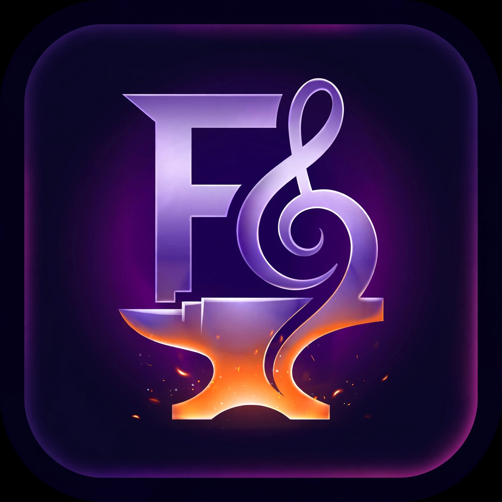

<div align="center">



# FunkForge (Beta)

**A modern desktop app for browsing, installing and managing Friday Night Funkin' mods.**

[-blue.svg)](https://github.com/Makerxm800/FunkForge/releases)
[](https://www.electronjs.org/)
[](License)
[]()

[Download](#-download) • [Features](#-features) • [Mods folder](#-where-is-my-mods-folder) • [Develop](#-developing) • [Privacy](#-privacy)

</div>

---

## ✨ What is FunkForge (Beta)?

FunkForge is an **Electron** desktop app that finds, installs and manages
*Friday Night Funkin'* mods. It talks to the public
[GameBanana](https://gamebanana.com) API to show real mods with real previews,
download counts and files — then keeps them tidy on your disk.

No hunting through game folders. No manual unzipping. Pick a mod, hit install,
play.

> **v2.0.0** is a full rewrite as an Electron app, replacing the old
> Python/tkinter version. The old code is kept under `legacy/python/` for
> reference.

---

## 📦 Download

Grab your platform's build from the
**[Releases](https://github.com/Makerxm800/FunkForge/releases)** page:

| Platform | File | What to do |
|---|---|---|
| **Windows 10/11** | `FunkForge-Beta-2.0.0-x64-win.exe` | Run the installer |
| **Windows (portable)** | `FunkForge-Beta-2.0.0-x64-portable.exe` | No install — just double-click |
| **macOS (Intel)** | `FunkForge-Beta-2.0.0-x64-mac.dmg` | Open the DMG, drag the app to Applications |
| **macOS (Apple Silicon)** | `FunkForge-Beta-2.0.0-arm64-mac.dmg` | Same as above |
| **Linux** | `FunkForge-Beta-2.0.0-x64.AppImage` | `chmod +x` then run it |
| **Linux (Debian/Ubuntu)** | `FunkForge-Beta-2.0.0-x64.deb` | `sudo apt install ./FunkForge-Beta-2.0.0-x64.deb` |

> ### ⚠️ First-launch warnings — these are normal
>
> The builds are **unsigned**, because code-signing certificates cost hundreds
> of dollars a year and this is a free, open-source hobby project. Nothing is
> wrong with the files, and you can verify that by reading the source.
>
> - **Windows SmartScreen:** *"Windows protected your PC"* → **More info → Run anyway**
> - **macOS Gatekeeper:** right-click the app → **Open** the first time, or allow it
>   under *System Settings → Privacy & Security*
> - **Linux:** `chmod +x FunkForge-Beta-2.0.0-x64.AppImage`

---

## 🚀 Features

### 🔎 Discover
- Search GameBanana across **Mods, Tools and Sounds** at once
- Rich cards with real preview art, author, download counts and engine tag
- Automatic **engine detection** (Psych, Kade, Codename, V-Slice, Forever…)
- 🌟 Flags **official** Funkin' Crew releases
- Sort by downloads / likes / newest / recently updated / A→Z
- Infinite scroll, or hit **Load more**

### 📁 Installed
- Everything in your mods folder, with size, engine and detected executable
- **Launch** a mod directly, or **uninstall** it
- Grid or compact list layout

### 🎨 Interface
- 7 themes: Midnight, Dark, Light, Ocean, Sunset, Forest, Rosegold
- Custom frameless titlebar (native traffic lights on macOS)
- Real native folder/file pickers and OS notifications
- Keyboard shortcuts: `/` to search, `Esc` to close, `←`/`→` for gallery images

### ⚡ Under the hood
- Local backend with a **disk image cache** — scrolling back doesn't re-download art
- Downloads and extraction handled natively; single-folder zip wrappers are
  unwrapped automatically
- No runtime dependencies in the app itself

---

## 📂 Where is my mods folder?

It's **always visible in the sidebar**, bottom-left — you can't miss it:

```
┌─ Sidebar ────────────┐
│  🔎 Discover         │
│  📦 Installed      3 │
│  🕘 History          │
│  ⚙  Settings         │
│                      │
│  📁 MODS FOLDER      │
│  ┌────────────────┐  │
│  │ /Users/me/     │  │
│  │  FunkForgeMods │  │
│  └────────────────┘  │
│  [ Open ] [ Change ] │
└──────────────────────┘
```

- **Open** → reveals it in Explorer / Finder
- **Change** → native folder picker

The default is `~/FunkForgeMods` (`C:\Users\you\FunkForgeMods` on Windows).
You can also change it in **Settings → Library**.

---

## 🔒 Privacy

> **TL;DR — FunkForge sends nothing anywhere except GameBanana, and only to
> look up mods you asked for. No telemetry, ever.**

| | |
|---|---|
| ✅ **No telemetry** | We do not track you. Ever. |
| ✅ **No analytics** | No Google Analytics, no pixels, no hidden callbacks. |
| ✅ **No ads** | Zero ads, zero sponsors. |
| ✅ **No accounts** | No sign-up, no login, no email. |
| ✅ **No data sold** | Nothing is shared or sold, because nothing is collected. |

The only remote host contacted is **`gamebanana.com`** — the public mod
database — and only to search, preview and download mods you requested.
There is no FunkForge server; there is no backend to phone home to.

Everything is stored locally:

| Path | Purpose |
|---|---|
| `~/Library/Application Support/funkforge/` (macOS) | settings, history, cache |
| `%APPDATA%/funkforge/` (Windows) | settings, history, cache |
| `~/.config/funkforge/` (Linux) | settings, history, cache |

**Verify it yourself:** `grep -rn "http" electron/ renderer/` — the only
external host is GameBanana. Block it in your firewall and the app still
launches fine.

---

## 🛠️ Developing

Requires **Node 18+** (and Python 3 with Pillow only for regenerating icons).

```bash
git clone https://github.com/Makerxm800/FunkForge.git
cd FunkForge
npm install

npm start          # run the Electron app
npm run preview    # backend + UI in your browser (no Electron needed)
```

`npm run preview` is handy because the renderer talks to the backend over
plain HTTP — so the **exact same UI** runs in a browser and inside Electron.
That's what makes the browser preview faithful rather than a mock-up.

### Project layout

```
electron/
  main.js       Electron main process: window, native dialogs, IPC
  preload.js    contextBridge — the only OS access the UI gets
  server.js     local backend: GameBanana proxy, disk cache, mods fs, zips
renderer/
  index.html    the UI shell
  css/          design system + 7 themes
  js/app.js     UI logic
assets/         source logo
build/          generated icon.ico / icon.icns / icon.png
tools/          make_icons.py
legacy/python/  the pre-2.0 Python/tkinter version
```

### Building installers

```bash
npm run icons      # regenerate build/icon.{ico,icns,png}
npm run dist:win   # Windows NSIS + portable
npm run dist:mac   # macOS dmg + zip (x64 and arm64)
npm run dist:linux # AppImage + deb
```

Or on CI: push a `v*` tag and
`.github/workflows/build-release.yml` builds all three natively and publishes
a Release.

---

## 🙏 Credits

Built by **Makerxm800**.

*Friday Night Funkin'* is made by **The Funkin' Crew Inc.**
FunkForge is an **UNOFFICIAL fan tool** and is not affiliated with or endorsed
by them. Mod data comes from **GameBanana**; all mods belong to their
respective creators.

---

## 📜 License

**MIT** — free to use, modify and share. See [License](License).

**FunkForge (Beta) v2.0.0** · stay funky 🎤🔥
